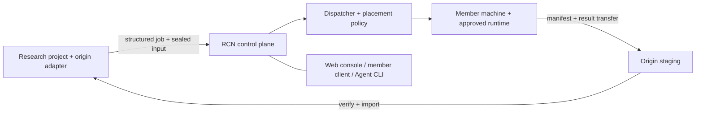

# Research Compute Network

**Shared research compute, with machine owners in control and results traceable to their source.**

[简体中文](README.zh-CN.md) · [Quickstart](docs/quickstart.md) · [Architecture](docs/architecture.md) · [Member guide](docs/member-guide.md)

RCN coordinates research jobs across a group of contributed machines. It provides a Python control plane, resource-aware scheduler, dispatcher, browser console, Windows member client, and a CLI for personal Agent access. Projects submit structured jobs through registered execution profiles; RCN tracks placement, attempts, recovery, result manifests, and audit events.

This checkout contains the **0.15.0a5 public-preview candidate**, extracted from a system used in a private research group. The source includes real scheduling and operations code. Public examples and the local demo use synthetic data. Internal use does not establish unattended deployment or acceptance in another lab.


[Forthcoming alpha.5 downloads](https://github.com/Patr1ck2005/rcn/releases/tag/v0.15.0-alpha.5). This is candidate source; alpha.5 downloads will become available after the release is published. Release wheels include the built console, and the Windows client installer includes Python and client dependencies.

## What it does

- **Share machines on explicit terms.** Owners choose participation, resource budgets, availability windows, and pause/drain controls. Administrators act through permission checks and audited operations.
- **Explain scheduling decisions.** Placement diagnostics expose capacity, memory, profile, permission, and runtime gates instead of leaving a job silently queued.
- **Recover the original work.** Jobs, work units, and attempts retain their identities through interrupted transfers and reconciliation; retries depend on failure classification.
- **Keep the research project authoritative.** Results carry manifests and hashes. The originating adapter verifies and imports data; RCN does not decide scientific validity.
- **Inspect and operate together.** The console covers jobs, fleet state, cluster insights, approvals, and member access. `rcn-agent` exposes structured plan, submit, watch, diagnostics, and collect operations.

## Try it locally

Requirements: Python 3.11+ and Node.js 20.19+ or 22.12+ to build the console. Install from this checkout; these instructions do not assume a PyPI release.

```powershell
git clone https://github.com/Patr1ck2005/rcn.git
cd rcn
python -m venv .venv
.\.venv\Scripts\Activate.ps1
npm --prefix web ci
npm --prefix web run build
python -m pip install .

$env:RCN_HOME = Join-Path ([IO.Path]::GetTempPath()) 'rcn-public-demo'
$env:RCN_DATABASE_URL = 'sqlite:///' + (Join-Path $env:RCN_HOME 'demo.db').Replace('\', '/')
python -m research_compute_network.cli serve --demo --host 127.0.0.1 --port 18882
```

Open **http://127.0.0.1:18882/app/overview**. The simulator animates synthetic machines and jobs; no solver, remote machine, or scientific runtime is needed. Stop it with `Ctrl+C`. Use a dedicated `RCN_HOME` and database, as above, to keep demo state separate from any existing deployment. See the [quickstart](docs/quickstart.md) for macOS/Linux, checks, and troubleshooting.

The console currently uses Chinese labels. The HTTP API and Python contracts are available for integration; English UI localization is not part of this preview.

## From demo to a working group



The public source covers the control plane, scheduling, dispatch, member tools, and integration contracts. **A registered scientific profile is a contract, not an installed solver.** Scientific execution requires separately supplied adapters, approved runtime archives, licensed software where applicable, and an operator-configured transport and enrollment flow. This repository supplies no COMSOL installation, scientific templates, project data, or sealed scientific runtime ZIPs.

Start with [architecture](docs/architecture.md), then [adapters and runtimes](docs/adapters-and-runtimes.md). Members of an already configured group can follow the [member guide](docs/member-guide.md). Starting the demo does not create a public compute service or enable compute onboarding.

## Develop and contribute

```powershell
python -m pip install -e ".[dev]"
python -m pytest
npm --prefix web test
npm --prefix web run build
```

The frontend build writes generated assets into the Python package for local use and wheel assembly. Keep generated assets, screenshots, runtime archives, credentials, and local state out of source commits. See [contributing](docs/contributing.md), [security](docs/security.md), and the [preview release notes](docs/releases/0.15.0a5.md).

## License

RCN source is licensed under [MIT](LICENSE), copyright 2026 Patr1ck2005. Dependencies retain their own licenses; the RCN MIT license does not relicense third-party code, bundled components, external runtimes, or commercial solvers. See [third-party notices](docs/third-party-notices.md).

Member task-package preparation: [offline/client and Agent guide](docs/member-task-package-guide.zh.md). Release sharing and artifact checks: [public export contract](docs/public-export.md).
