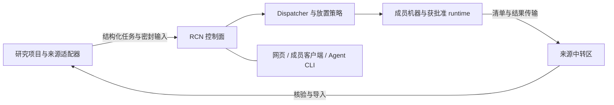

# Research Compute Network

**让研究组共享计算资源，让机主保留控制权，让结果有据可查。**

[English](README.md) · [快速开始](docs/quickstart.md) · [架构](docs/architecture.md) · [成员指南](docs/member-guide.md)

RCN 负责把结构化科研任务分配到研究组贡献的机器上，提供 Python 控制面、资源调度、Dispatcher、网页控制台、Windows 成员客户端，以及个人 Agent CLI。任务按登记的执行 Profile 运行，系统记录放置条件、运行尝试、恢复过程、结果清单与审计事件。

当前版本是 **0.15.0a1 公开预览版**，从研究组实际使用的系统中提取通用源码。调度与运维代码来自真实使用；公开示例和本地 demo 全部使用合成数据。组内使用经历不等于陌生实验室已完成部署验收。

## 可以做什么

- **按机主意愿贡献机器。** 设置资源预算、可用时段、暂停与排空；管理员操作经过权限检查并留下审计。
- **解释为什么排队。** 放置诊断逐项显示容量、内存、Profile、授权和 runtime 条件。
- **沿原任务恢复。** Job、Unit、Attempt 保留身份，传输中断先对账，按失败类型决定是否有界重试。
- **结果回到来源项目。** 清单与哈希支撑完整性核验，来源适配器负责正式导入与科学分析。
- **网页与 Agent 共用契约。** 控制台查看任务、机器、集群统计和审批；`rcn-agent` 提供结构化计划、提交、观察、诊断和回收操作。

## 本地试用

需要 Python 3.11+；构建网页需要 Node.js 20.19+ 或 22.12+。从源码安装，不依赖 PyPI 已发布。

```powershell
git clone https://github.com/Patr1ck2005/rcn.git
cd rcn
python -m venv .venv
.\.venv\Scripts\Activate.ps1
npm --prefix web ci
npm --prefix web run build
python -m pip install .

$env:RCN_HOME = Join-Path ([IO.Path]::GetTempPath()) 'rcn-public-demo'
$env:RCN_DATABASE_URL = 'sqlite:///' + (Join-Path $env:RCN_HOME 'demo.db').Replace('\', '/')
python -m research_compute_network.cli serve --demo --host 127.0.0.1 --port 18882
```

打开 **http://127.0.0.1:18882/app/overview**。demo 会模拟机器与任务变化，不连接远程机器、不运行求解器，也不需要科学 runtime。按 `Ctrl+C` 停止。明确设置独立 `RCN_HOME` 与数据库，避免与已有部署共用状态。macOS/Linux 步骤与排障见[快速开始](docs/quickstart.md)。

当前控制台以中文为主，英文界面本地化尚未包含在本预览版中。

## 接入实际计算



公开源码包括控制面、调度、派发、成员工具与集成契约。**登记了科学 Profile，不表示已安装可执行它的求解器。** 实际计算还需要单独提供来源适配器、获批准的 runtime 档案、相应软件许可，以及管理员配置的传输和接入流程。本仓库不包含 COMSOL 安装、科学模板、项目数据或密封科学 runtime ZIP。

部署者先读[架构](docs/architecture.md)和[适配器与 runtime](docs/adapters-and-runtimes.md)；已有受管中心的成员使用[成员指南](docs/member-guide.md)。启动 demo 不会自动建立公共计算服务或开放计算节点接入。

## 开发与许可

```powershell
python -m pip install -e ".[dev]"
python -m pytest
npm --prefix web test
npm --prefix web run build
```

网页构建产物用于本机运行和 wheel 打包，不提交到源码历史。生成截图、runtime 档案、凭据与本地状态同样不入库。参见[贡献指南](docs/contributing.md)、[安全说明](docs/security.md)和[版本说明](docs/releases/0.15.0a1.md)。

RCN 源码采用 [MIT](LICENSE)，版权归 2026 Patr1ck2005。依赖保留各自许可证；MIT 不覆盖第三方组件、外部 runtime 或商业求解器，详见[第三方说明](docs/third-party-notices.md)。
