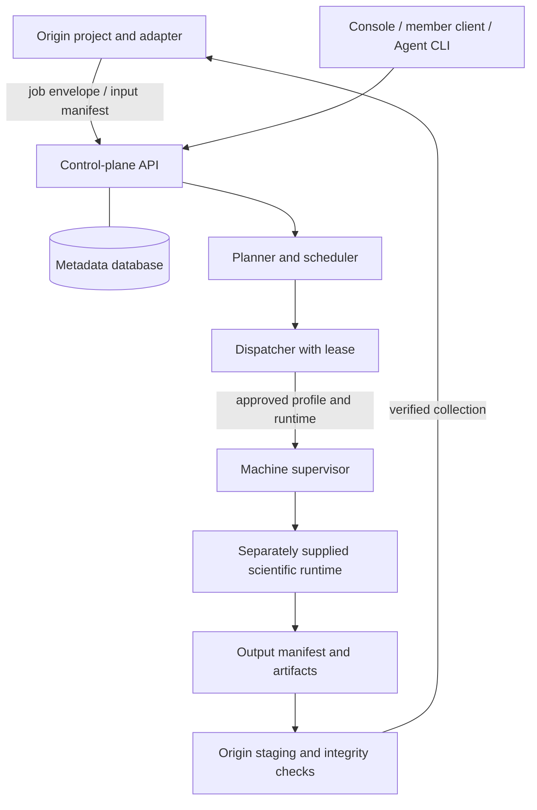

# Architecture

[Home](../README.md) · [Adapters and runtimes](adapters-and-runtimes.md) · [Security](security.md)

RCN separates the research workflow from the machines that execute it. A project defines a structured workload; RCN decides where approved work may run, records what happened, and returns evidence to the project.

## Components and ownership

| Component | Responsibility |
|---|---|
| Origin adapter | Compile project intent into immutable atomic items, seal inputs, verify collection, and import results. |
| Control plane | Identities, permissions, project grants, machine policies, approvals, jobs, attempts, manifests, and audit events. |
| Planner / scheduler | Partition work and evaluate placement against runtime, capability, resource, and policy gates. |
| Dispatcher | Hold a scheduling lease, deliver assignments, reconcile uncertain execution, and collect results. |
| Machine supervisor | Heartbeat, telemetry, approved process lifecycle, precise cancellation, and runtime attestation. |
| Scientific runtime | Execute the declared profile under the approved contract. Supplied and validated separately. |
| Member tools | Personal login, task-package planning/submission/collection, and owner-controlled machine participation. |

The metadata database records manifests and hashes rather than owning scientific datasets. A deployment can still transfer sealed inputs and outputs through `origin-spool` and dispatcher staging directories. Those bytes need explicit storage, retention, and access policies. Collection back to the origin remains a separate step.

## Work identity and recovery

An **atomic item** is the smallest declared piece of work. A **work unit** groups atomic items for one scheduled execution. A **job** owns the unit set; an **attempt** records a particular execution of a unit.

The execution path is:

1. The origin creates a sealed input and structured job with a registered profile and resource request.
2. Planning establishes the unit partition and the client confirms the plan.
3. Placement checks permissions, owner policy, runtime approval, capabilities, capacity, memory, and other resource gates.
4. The dispatcher assigns a unit; the supervisor reports execution evidence under its original identity.
5. Result transfer and manifest checks complete; the origin adapter collects, verifies, and imports.

An interrupted connection does not prove a failed computation. Reconciliation queries the original attempt before retrying. Failure classifications distinguish input/scientific errors from infrastructure/resource failures, so a new attempt is an explicit, bounded decision. Result collection and execution are distinct phases: a completed solve may still be transferring or awaiting verification.

For a queued job, inspect `GET /v1/jobs/{job_id}/placement-diagnostics`. A healthy API alone does not establish worker readiness or available compute.

## Resource semantics

Owners can set participation, resource budgets, availability, and pause/drain policies. Machine and profile limits constrain admission. Memory requests are scheduling reservations and accounting, not operating-system memory isolation. CPU enforcement depends on the configured execution backend. The Windows shared-machine path reserves at least 25% of the scheduling thread budget; this is not a guarantee of OS CPU-time isolation.

Operational charts summarize recorded execution and current telemetry. Their ETA and utilization describe the selected jobs and observation window; they do not establish scientific validity or a universal throughput guarantee.

## Public preview boundary

The public repository includes the generic RCN services, contracts, clients, and synthetic demo. The research-group deployment uses separately managed scientific adapters, templates, solver installations, and approved runtime archives. Those are not included here. Existing scientific profile identifiers remain in the contracts for compatibility; seeing them in the UI does not mean that runtime is available.

The implementation was used in a private research group. The public preview does not claim independent external deployment, compatibility with every machine, or self-service compute onboarding. The [integration guide](adapters-and-runtimes.md) describes what an operator still needs to supply.
